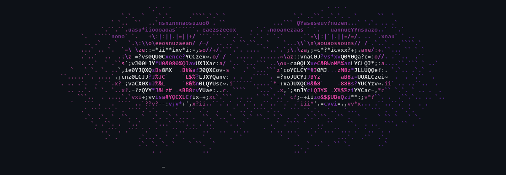

# Erfan Zamani

Computer Science @ McMaster University · Machine Learning & Software Engineering

 

<h3 align="center">About</h3>

<b>Now</b> · ML research on image enhancement @ McMaster University 
<b>Previously</b> · Voice-based sleep apnea screening @ KITE Research Institute, UHN 
<b>Community</b> · Building AgentGuard, AI-agent security @ McMaster's Google Developer Groups club 
<b>Open to</b> · Software engineering and machine learning internships 
<b>Off the keyboard</b> · Competitive math, tutoring, residence Community Advisor

 

<h3 align="center">Projects</h3>

<table align="center">
<tr>
<td width="50%" valign="top">

#### [Orbitour](https://github.com/Erunixz/Orbitour)

AI trip planner with a 10-stage multi-agent pipeline and 3D city navigation

</td>
<td width="50%" valign="top">

#### [thru.io](https://github.com/Erunixz/thru.io)

Fully AI-powered drive-through and kitchen display with multilingual voice ordering, built at the 2026 Mac-a-Thon

</td>
</tr>
<tr>
<td width="50%" valign="top">

#### [SweepMate](https://github.com/Erunixz/SweepMate) (in progress)

Offline-first PWA for overnight residence rounds: guided walkthroughs, occupancy counts, incident notes, and one-tap StarRez reports. Currently under review by McMaster as an official tool for Community Advisors

</td>
<td width="50%" valign="top">

#### [NUBB-E](https://github.com/Erunixz/NUBB-E) (in progress)

Fully offline personal AI assistant: a local LLM with an animated face, voice chat, long-term memory, and file and screen actions that never run without your approval

</td>
</tr>
</table>

 

<h3 align="center">Stack</h3>

<table align="center">
<tr><td width="25%"><b>ML / AI</b></td><td></td></tr>
<tr><td><b>Web</b></td><td></td></tr>
<tr><td><b>Languages</b></td><td></td></tr>
<tr><td><b>Data & Tools</b></td><td></td></tr>
</table>

 

  <picture>
    <source media="(prefers-color-scheme: dark)" srcset="./eyes.gif" />
    <source media="(prefers-color-scheme: light)" srcset="./eyes-light.gif" />
    
  </picture>

